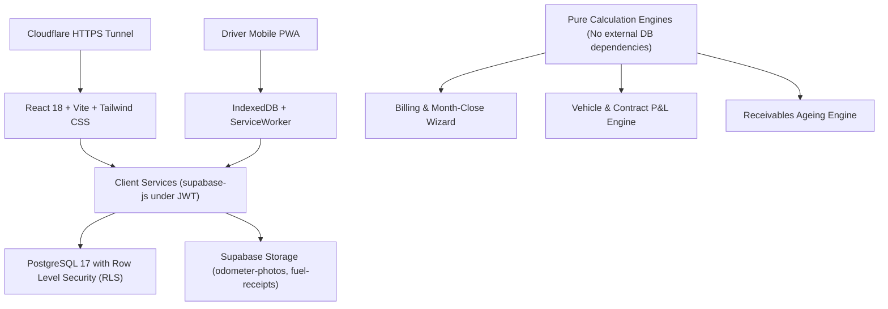

# Starciti Group & City Tours & Travels — Fleet & Billing Desk

A comprehensive, production-grade fleet management, driver logging, and billing automation desk built for **Mr. M. Ratnaraj** (City Tours & Travels / Starciti Group, Trivandrum, Kerala).

---

## 1. System Architecture & Tech Stack



- **Frontend**: React 18, TypeScript, Vite, Tailwind CSS, Lucide Icons, PWA with Service Worker & IndexedDB offline cache.
- **Data Layer**: Direct `supabase-js` client operating under authenticated user JWTs (`auth.uid() -> app_users.role`). **Zero** direct `pg` imports in client code.
- **Backend / Microservices**: Self-Hosted Supabase suite via Docker Compose:
  - **PostgreSQL 17**: With `pgjwt`, `pgcrypto`, and forced Row Level Security (`FORCE ROW LEVEL SECURITY`).
  - **GoTrue Auth**: Email/password authentication, JWT issuance, TOTP 2FA.
  - **PostgREST v16.5**: REST API over PostgreSQL.
  - **Supabase Storage v1.96**: Bucket `odometer-photos` with private access and driver folder isolation.
  - **Supabase Studio**: Database management web interface bound strictly to `127.0.0.1:54323`.
  - **Kong API Gateway**: Unified routing bound strictly to `127.0.0.1:54321`.
  - **Nginx Frontend Container**: Production SPA server with gzip, security headers, and reverse proxy.
  - **Cloudflare Tunnel (`cloudflared`)**: Outbound encrypted HTTPS tunnel with zero open router ports.

---

## 2. Verified Data Provenance vs. Sample Demo Data

In accordance with strict owner instructions, the system maintains complete transparency between verified real data and demonstration sample records:

### Confirmed Real Data (From Owner Files & Invoices)
- **Real Customers**:
  - `M/s Vindhya Telelinks Limited (VTL)` (Contract & Aug 2026 Logbook).
  - `Global Public School` (School Invoice Photo `invoice-106562`).
- **Real Active Fleet**:
  - `KL 01 CP 3284` ('7-Seat AC Car' from VTL invoice).
  - `KL 82 4889` ('Ertiga').
  - `KL 74 E 3694` ('Substitute' vehicle).
  - `KL 21 M 2378` ('Dzire').
- **Real Drivers**:
  - `Hemanth Kumar`, `Muhammad Fayaz.s`, `Asheerkhan`, `Afzal`.
- **Active Invoice Series**:
  - Dedicated `TEST` series for pilot testing (`TEST-0001`, `TEST-0002`). Real series await owner's last numbers.

### Demonstration Sample Data (One-Click Purgeable)
- All mock bank accounts, sample cash transactions, and phantom records are explicitly flagged with `is_sample_data = TRUE`.
- **One-Click Purge**: Navigate to **Settings > Sample Data & Reset** and click **"Remove All Sample Data Now"**. Automated tests (`dataProvenance.test.ts`) verify that zero real records are touched.

---

## 3. Operations & Quick Commands

All commands run from PowerShell in `E:\projects\starcity`:

```powershell
# 1. Check complete system health (Docker, DB, Kong, Auth, Storage, Frontend)
node scripts/check_server_health.cjs

# 2. Start the self-hosted Docker stack
docker compose up -d

# 3. Generate production secrets (stored only in git-ignored .env.production)
node scripts/setup_self_hosted_secrets.cjs

# 4. Initialize fresh production database (clean DDL + real masters + TEST series)
node scripts/init_production_database.cjs

# 5. Run automated nightly backup (dumps DB, AES-256 encrypts, syncs to D:\StarcitiBackups)
node scripts/backup_production.cjs

# 6. Test restore drill (decrypts, verifies SHA-256 checksum, audits row counts)
node scripts/restore_production.cjs

# 7. Run full Vitest test suite (192 tests across 24 test suites)
npx vitest run
```

---

## 4. Documentation Index

- [Production Deployment Guide](file:///e:/projects/starcity/docs/deployment_guide.md): Complete setup guide for self-hosted Windows Docker + Cloudflare Tunnel.
- [Self-Hosted Runbook](file:///e:/projects/starcity/docs/self_hosted_runbook.md): Daily operations, auto-start after reboot, firewall rules, and updates.
- ["PC is Down" Disaster Recovery Runbook](file:///e:/projects/starcity/docs/pc_down_disaster_recovery.md): 15-minute emergency recovery procedure on any replacement laptop.
- [Monthly Restore Drill Reminder (.ics)](file:///e:/projects/starcity/docs/Starciti_Monthly_Backup_Drill.ics): Calendar event for the 1st of every month.
