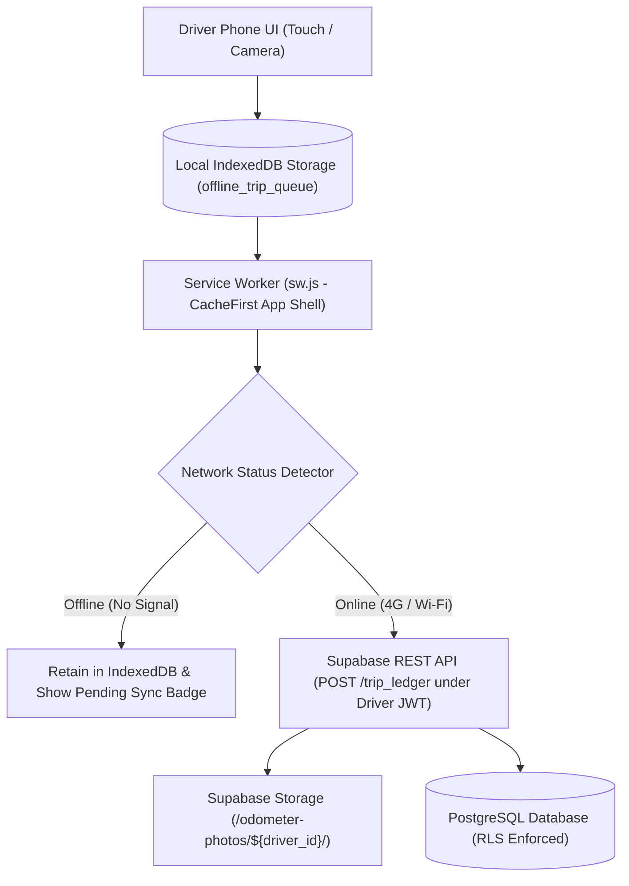

# Driver Mobile PWA: Physical Phone Field Testing Checklist

**Author:** Antigravity Engineering  
**Application:** Starciti & City Tours Fleet Management Desk  
**Target Device:** Android Smartphone (Google Chrome 110+) / iOS (Safari 16.4+)  
**Target Role:** Fleet Driver (e.g., Hemanth Kumar)  
**Version:** Milestone 9 Hardening Release  

---

## 1. Architecture Summary

The Driver PWA is designed specifically for Kerala and South Indian field road conditions, where cellular data signals (4G/5G) frequently drop during ghat, outstation, or monsoon trips.

---

## 2. Pre-Flight Setup & Phone Prerequisites

| Step | Action | Expected Result | Pass / Fail |
| :--- | :--- | :--- | :--- |
| **P-1** | Open Google Chrome on the Android phone and navigate to: `https://<YOUR_DEPLOYED_URL>/#driver` (or local Wi-Fi IP `http://192.168.x.x:4173/#driver`). | Driver Mobile portal loads with large touch-friendly buttons and dark navy/slate theme. | [ ] |
| **P-2** | Tap the Chrome three-dot menu (⋮) -> Select **"Add to Home Screen"** or **"Install App"**. | Chrome prompts *"Install Starciti Fleet Driver"* with the official vehicle icon. | [ ] |
| **P-3** | Complete installation and return to phone home screen. | App icon *"Starciti Driver"* appears on Android home screen alongside native apps. | [ ] |
| **P-4** | Tap the home screen icon to launch. | Opens in **Standalone Window Mode** (no Chrome address bar, no navigation controls, native app feel). | [ ] |

---

## 3. Physical Test Protocols

### Protocol A: Live Camera & Photo Compression Test
*Validates that photos taken on modern high-megapixel phones (48MP - 200MP) do not fail uploads or exhaust data plans.*

- [ ] **Step A-1:** On the Driver Duty screen, tap **"Capture Start Odometer Photo"**.
- [ ] **Step A-2:** Ensure the phone's native camera opens directly (not file picker). Capture a clear picture of the car dashboard odometer.
- [ ] **Step A-3:** Inspect client-side compression: Verify that the image is compressed on-device to `< 250 KB` (WebP/JPEG format, max 1280px width) before transmission.
- [ ] **Step A-4:** Verify that EXIF geolocation and orientation metadata are normalized so the dashboard photo is right-side up.

---

### Protocol B: Full Airplane Mode (Offline) Duty Logging
*Proves that a driver in zero-signal areas can log multiple duty runs without losing data.*

- [ ] **Step B-1:** On your phone, pull down the quick settings shade and **Enable Airplane Mode** (verify Wi-Fi and Cellular icons disappear).
- [ ] **Step B-2:** Return to the Starciti Driver app. Confirm the top status bar displays:  
  `🔴 Offline Mode - Trips will be saved locally and synced when signal returns`.
- [ ] **Step B-3 (Trip 1):** Enter Start Duty:
  - Date: `2026-08-10`
  - Start Odometer: `156100 km` | Start Time: `08:00`
  - Close Odometer: `156220 km` | Close Time: `18:30`
  - Total KM: `120 km` | Vehicle: `KL 01 CP 3284`
  - Tap **"Save Duty Entry"**.
- [ ] **Step B-4:** Verify the entry appears immediately on the local duty list with an amber badge:  
  `⏳ Pending Sync (Saved in phone memory)`.
- [ ] **Step B-5 (Trip 2):** Immediately log an evening outstation extension or second trip. Verify both entries remain cleanly queued in local IndexedDB without any freeze or crash.

---

### Protocol C: Reconnection & Automatic Background Sync
*Validates that the offline queue drains and persists to PostgreSQL as soon as cellular data reconnects.*

- [ ] **Step C-1:** Pull down phone settings and **Disable Airplane Mode** (restore 4G/5G or Wi-Fi).
- [ ] **Step C-2:** Watch the Driver App banner without refreshing the page.  
  *Expected:* The connection listener triggers automatically:  
  `🟢 Signal Restored - Syncing 2 pending entries...`
- [ ] **Step C-3:** Within 2-5 seconds, verify both entries transition from `⏳ Pending Sync` to:  
  `✓ Synced with Office Desk (Server ID verified)`.
- [ ] **Step C-4:** Open the Office Desk on a computer (`/#ledger`). Confirm that the two trips logged offline appear in the office grid in real-time.

---

### Protocol D: Cold Cache App Startup Test
*Validates that the app starts from zero even when the phone has no signal at all upon launch.*

- [ ] **Step D-1:** Force-close the Starciti Driver app and Google Chrome from Android Recent Apps.
- [ ] **Step D-2:** Re-enable **Airplane Mode**.
- [ ] **Step D-3:** Tap the *"Starciti Driver"* home screen icon while still completely offline.
- [ ] **Step D-4:** Verify that the Service Worker serves the entire application shell from cache:
  - App shell loads in `< 1.0 second`.
  - Driver name and assigned vehicle remain visible.
  - Previous synced duty entries remain readable from IndexedDB.

---

### Protocol E: Anomaly & Conflict Detection
*Validates that driver mistakes (odometer typos) are flagged before causing invoice errors.*

- [ ] **Step E-1:** Attempt to enter a Close Odometer that is **less** than the Start Odometer (e.g. Start: `156300`, Close: `156200`).  
  *Expected:* Form refuses to submit with red error message: *"Close odometer cannot be less than start odometer."*
- [ ] **Step E-2:** Attempt to log a trip with a start odometer that leaves a gap `> 15 km` from the previous close (e.g. Previous Close: `156220`, Next Start: `156300` = 80 km gap).  
  *Expected:* System prompts confirmation: *"Mileage Gap Detected (80 km gap). Was this vehicle driven for personal use, another duty, or is this a typo?"*

---

## 4. Verification Sign-Off

| Tested By | Phone Model & OS | Date | Verification Result | Signature |
| :--- | :--- | :--- | :--- | :--- |
| Driver / Supervisor: | Android Version: | `2026-` | **[ ] PASS** / **[ ] FAIL** | |

*Completed checklists should be filed in the fleet compliance folder for audit reference.*
