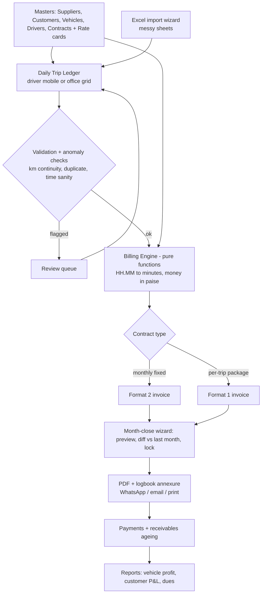

# PROMPT FOR ANTIGRAVITY — "Starciti Fleet & Billing Desk"

> How to use: create an empty project, drop the 4 reference files into `/reference/`
> (`ui_mockup.html`, `invoice_format1_school.png`, `invoice_format2_VTL_Aug2026.pdf`, `Log_book_VTL_Aug_2026.xlsx`),
> then paste everything below the line into Antigravity **in Planning mode**.

---

## 0. ROLE AND GOAL

You are a senior full-stack engineer and product designer. Build a production-grade web app (installable PWA) for **Starciti**, a Trivandrum (Kerala, India) taxi / travel / contract-car business run by Mr. M. Ratnaraj. It runs under more than one trade name (see §3.1).

The app replaces Excel logbooks, hand-typed invoices and paper notes. Its single most valuable job:

> **Drivers/staff log every trip once (daily ledger) → the system applies the customer's contract rules → a correct, print-ready invoice (Format 1 or Format 2) is generated at month end in one click, with the logbook attached.**

Everything else (quotes, bookings, fleet, staff, expenses, accounts, reports) is already sketched in the UI mockup and must be built too, but the **ledger → billing engine → invoice** spine is priority #1.

Work in this order: (1) read every reference file, (2) produce an implementation plan + task list, (3) ask me about every item tagged **[CONFIRM]**, (4) build milestone by milestone (§14), running tests and verifying UI in the browser after each milestone.

## 1. REFERENCE FILES (read all, they are the source of truth)

| File | What it is |
|---|---|
| `ui_mockup.html` | Approved look & feel + module list. Reuse its design tokens (colors, Space Grotesk + Inter, sidebar, cards, pills, flag notes, doc-preview panel, driver phone view, modals). Do not redesign; extend. |
| `invoice_format1_school.png` | **Format 1** — per-trip itemised invoice (customer: a school, vehicles on daily hire). Photo has **handwritten change requests** (§6.1). |
| `invoice_format2_VTL_Aug2026.pdf` | **Format 2** — monthly fixed-contract invoice (customer: Vindhya Telelinks Ltd, 7-seat AC car with driver). |
| `Log_book_VTL_Aug_2026.xlsx` | Daily trip ledger. Sheets: `Aug` (2026, the clean one), `VTL Log` (Aug 2025, older layout), `ALL` (Jan 2026, **messy**, use it as an import stress test), `Extra Trip` (non-contract trips, e.g. Dzire), `Sheet2` (empty). |

## 2. APPROACH (flow)



## 3. DOMAIN FACTS DISCOVERED FROM THE FILES (do not lose these)

### 3.1 Business identity
- Letterheads seen: **"StarCiti Group"** (Format 1, has logo + "24x7" taxi collage), **"M/S City Tours & Travels"** (Format 2 and logbook header), **"Starciti Travels"** (mockup). Same owner/address (Killipalam, Trivandrum 695002).
- Build **Supplier profiles** (billing entities): legal name, trade name, address, phone(s), email, PAN, GSTIN (optional), SAC code (996601), bank details, logo, default footer/promo text, invoice number series. Each invoice picks one profile.
- In Format 1 the "Tax no." printed is a **phone number**. Make Tax/GSTIN a validated optional field (GSTIN 15-char regex; PAN 10-char regex) so this cannot happen again. **[CONFIRM]** which profile Format 1 should use.

### 3.2 Format 1 — per-trip package billing (verified against all 8 lines in the photo, matches to the rupee)
Customer: school, sedan on daily hire. Each line = one vehicle-day. Rule (sedan):

```
base package  = ₹2,415   covers 10 hours and 80 km
extra hour    = ₹200 / hour  (pro-rata by minute)
extra km      = ₹15 / km
amount = 2415 + max(0, hours-10)*200 + max(0, km-80)*15
```
Verified examples: 82 km, min hrs → 2,445 · 12h15 min km → 2,865 · 11h & 84 km → 2,675 · 11h45 → 2,765 · 10h15 & 90 km → 2,615 · 10h30 → 2,515 · min/min → 2,415 · 12h30 → 2,915. (Printed page-1 total of these 8 = ₹21,210.)
- Hours are written **HH.MM** on paper ("12.15" = 12 h 15 min, "10.30" = 10 h 30 min, NOT 12.15 decimal).
- Same date can have 2 vehicles ("Vehicle 1", "Vehicle 2"). Issue date = due date on that invoice (make due-date terms configurable per customer, default "due on receipt").
- Rate cards must be **per customer × vehicle type** (sedan, Innova, Ertiga, Tempo Traveller…): base, included hours, included km, extra-hour rate, extra-km rate. Only the sedan card is known. **[CONFIRM]** others.

### 3.3 Format 2 — monthly fixed contract (VTL)
Agreement no. 202526000005308395, dated 01/11/2025, **valid up to 30 Sep 2026 (already expired today, 21 Nov 2026)** → build contract-expiry alerts (60/30/7 days) and block invoicing past expiry unless admin overrides with a reason. **[CONFIRM]** renewed agreement terms for Oct/Nov 2026.

Invoice rows/fields (keep this layout, see PDF): supplier/recipient blocks with PAN/GSTIN, agreement no./date/valid-till, invoice no./date, place of supply, SAC; table columns `SL | Description of Service | Fixed KM | Used KM | Period | Working days | Extra KM | Extra Hours | Extra Days | Fixed Amount @ monthly`; breakup box: `Extra Hours @ rate · Monthly fixed amount · Night bata · Airport tax · Toll & Permit · Extra KM @ rate · Outstation Bata · Total`; "Total Amount" and "Amount in words" (Indian system).

Aug 2026 rules inferred from the logbook (all confirmed against row data):
- Monthly fixed ₹65,000 includes 3,000 km. Extra km @ ₹18 only if used > fixed.
- **Included hours = 12 per day** (every `Additional Hours` entry equals day length − 12 h). Extra hour ₹150.
- Night bata ₹200/day (given on Aug 1 and Aug 22, both 05:00 starts) **[CONFIRM the trigger rule]**. Outstation bata ₹200/day (Aug 5, 16, 19). Permit ₹600 per Kanyakumari day (Aug 5, 16) → shown as "Toll & Permit" ₹1,200. Airport tax column exists (₹0 this month, although "Airport" appears in remarks Aug 1/12 → warn, don't assume).
- Non-running days are labelled in the Driver/Vehicle cell: `SUNDAY`, `ONAM`, `Holiday`; 2025 sheet used `No Run`. The invoice still shows **30 working days** while only **25 days ran** → store both: *contract days* (default 30, editable) and *actual run days*. **[CONFIRM]** how working days is decided; Extra Days = running on Sundays/holidays? **[CONFIRM]**
- Substitute vehicle/driver on 20 Aug (KL74 E 3694, Afzal, odometer 41,834) → ledger must allow vehicle/driver override per day; odometer continuity is per vehicle.
- **Older terms exist** (Aug 2025 sheet): fixed 2,700 km, ~10 included hours, night/outstation ₹250. So **contract terms are versioned with effective-from/to dates**; an invoice always uses the terms valid for its period.

### 3.4 BUGS FOUND IN CURRENT PAPER PROCESS (engine must prevent these; add them as regression tests)
1. **Hours HH.MM vs decimal.** Extra hours total is 1:00+1:15+1:00+0:30+1:00+3:30+1:30 = **9 h 45 min = 9.75 h**. Sheet/invoice treated "9.45" as decimal → billed ₹1,417.50 instead of ₹1,462.50. **Expected August total = ₹68,662.50 (issued: ₹68,617.50 → printed 68,617).** Under-billed ₹45. Store durations as integer **minutes**, never as decimals.
2. Sheet summary says `H37 = 8.45` but `K35 = 9.45` and the formula uses 9.45 → hard-coded totals. Engine totals must be derived from ledger rows only.
3. Used km: ledger sums to **1,884**, invoice printed **1,885**. Single source of truth = ledger; manual override only with reason + audit log.
4. Invoice total `68617.50` was printed as `68617` (round-down). Make rounding a setting: `none | nearest | down`, default `down` to match history. **[CONFIRM]**
5. K34 (Aug 31 extra hours) is a time-typed cell while others are numbers — mixed types. Fix by typed inputs.
6. Invoice numbers not sequential across formats (108190 dated 31 Aug vs 106562 dated 3 Sep). Use one series per supplier profile (prefix + financial year + running number), never reuse, gap-free, locked after issue.

### 3.5 Messy-data lessons from sheet `ALL` (Jan 2026) — import must survive this
Dates out of order; exact duplicate rows (rows 3 and 7); same vehicle spelled `KL 82 4889`, `Kl 82 4889`, `KLO CP 3284`, `KLO1CP3284`, `KLO13284`, `KLO1.3284`; driver spelled `Hemantha Kumar`, `Hemantha Kumar..`, `Hemanth`; times as text (`9.am`, `10.pm night`, `7Pm`, `5.15am`, `9.15p m`, `8.45`); close time earlier than start time (night shift or typo?); odometer typed as `0.142603`; start km repeating previous trip; start-after-end odometer. 

## 4. TECH STACK (defaults — tell me if you disagree)
React + Vite + TypeScript, Tailwind (port mockup CSS variables into the Tailwind theme), shadcn-style components, TanStack Query/Table, Zod, React Hook Form. Supabase (Postgres, Auth, Storage, Row Level Security, Edge Functions). PDF: server-side HTML→PDF (Playwright/Puppeteer in an edge/Node function) so PDFs are pixel-identical to preview. PWA with offline queue for the driver view. Vitest for the billing engine, Playwright for E2E. Hosted on Vercel. Free-tier friendly. India locale: `en-IN`, ₹, lakh/crore grouping, `DD/MM/YYYY`, timezone `Asia/Kolkata`.

## 5. DATA MODEL (Postgres; all tables have id, created_at, updated_at, created_by; soft-delete; audit_log trigger)

- `supplier_profiles` (see §3.1) · `invoice_series`
- `customers` (type: individual | agent | corporate | school | hotel | long_term; billing address; GSTIN/PAN; contact persons; payment terms; default supplier profile; default invoice format; flags)
- `vehicles` (reg no normalised `KL01CP3284` + display form, make/model, vehicle_type, seats, owned|hired, vendor_id, odometer, insurance/RC/pollution/permit/fitness expiry, EMI, service schedule)
- `drivers` (permanent | temporary | vendor-supplied; docs; validity dates; languages; contacts)
- `vendors` (hired-vehicle suppliers) · `investors`
- `contracts` (customer, supplier profile, agreement no./date, valid_from/valid_to, kind `monthly_fixed | per_trip_package | on_call_pool | hotel_contract`, invoice_format `F1|F2|…`, status) 
- `contract_terms` (**versioned**: effective_from/to, fixed_amount, included_km, included_hours_per_day, extra_hour_rate, extra_km_rate, night_bata, outstation_bata, night_bata_rule, working_days_rule, rounding_mode, gst_mode)
- `rate_cards` (contract × vehicle_type: base, included_hours, included_km, extra_hour_rate, extra_km_rate, min_charge)
- `trip_ledger` (**the daily ledger**): date, contract_id, customer_id, vehicle_id, driver_id, `day_status` (RUN | SUNDAY | HOLIDAY | NO_RUN | LEAVE | BREAKDOWN | SUBSTITUTE), start_km, close_km, start_time, close_time (+`ends_next_day` bool), vehicle_slot ("Vehicle 1/2"), tags[] (site/route like Kachani, AVP, Kattakada KSEB), remarks, night_bata, outstation_bata, airport_tax, toll, permit, parking, other_charges, odometer_photo_urls, source (`driver_app|office|import`), status (draft|submitted|approved|billed|locked), invoice_id
- `extra_trips` (the `Extra Trip` sheet: non-contract single trips with customer, trip details → billable via Format 1/regular)
- `invoices` (number, series, format, supplier_profile, customer, contract, period_from/to, issue_date, due_date, gst flag + breakdown, subtotal, round_off, total, words, status draft|issued|sent|part_paid|paid|overdue|cancelled, locked_at, pdf_url, snapshot_json of the engine output + terms used) · `invoice_lines`
- `payments` (invoice, date, mode, ref, amount, TDS deducted) · `credit_notes`
- `quotes`, `enquiries`, `bookings`, `trip_plans` (from mockup)
- `fuel_entries`, `expenses`, `maintenance`, `emi_schedule`, `attendance`, `salary_advances`, `incentives`
- `flags` (entity_type, entity_id, severity note|caution|avoid, text, author) — **never rendered on any customer-facing document**
- `holidays` (date, name, region) — used to pre-fill SUNDAY/ONAM/Holiday rows
- `app_users` (roles: admin, staff, driver, customer_viewer)

## 6. INVOICE FORMATS

### 6.1 Format 1 — "Per-trip itemised" (photo) **with the handwritten changes applied**
Printed original columns: `ITEM | PRICE | QUANTITY | AMOUNT`, with a free-text description like *"03/08/2026 Vehicle 1, City usage of sedan with 12.15 hours and minimum KM"*. Header: logo block, supplier address/phone/email/tax no., customer name+address, `INVOICE #`, `ISSUED`, `DUE`.

Handwritten instructions on the photo (read carefully):
1. In the ITEM column, replace the sentence with separate columns: **Date, Vehicle type, ~~Vehicle name~~, ~~Vehicle (1/2 label)~~ , Total hours, Total km.** (The words "Vehicle name" and the next word, probably "Vehicle no/1/2", are **struck through** → hide by default; keep as optional per-customer toggles.)
2. **QUANTITY is crossed out**; replace with: **Rate, Additional hours, Additional km.**
3. **AMOUNT stays as the last column** (written twice in the margin = emphasis).

Resulting default Format 1 table:

| Date | Vehicle type | Total hours | Total km | Rate | Additional hours | Additional km | Amount |
|---|---|---|---|---|---|---|---|
| 01/08/2026 | Sedan | 10:00 | 82 | ₹2,415 | 0:00 | 2 | ₹2,445 |
| 03/08/2026 | Sedan | 12:15 | 80 | ₹2,415 | 2:15 | 0 | ₹2,865 |

- "Rate" = base package rate; additional hours/km show quantity, with an option "also show extra-charge amount".
- Show hours as `HH:MM` on screen/PDF (never `12.15`).
- Footer: subtotal, GST block only if enabled, round-off, total, amount in words, bank/UPI details, promo line, signature block.
- When one day has 2 vehicles, two rows with the same date.
- Column set is a per-customer template setting (drag to reorder / show-hide), saved as `invoice_template` JSON, so new handwritten requests never need code changes. **[CONFIRM]** the exact struck-out word with me by showing the proposed columns.

### 6.2 Format 2 — "Monthly contract" (VTL PDF)
Replicate the PDF layout faithfully in HTML/CSS→PDF: bordered single-page sheet, centered supplier title with trade name, `INVOICE.` heading, two-column Recipient / Supplier block, agreement block, table (§3.3) and breakup box. Mapping from engine output (§7). Total in bold, amount in words in italics bottom-left. Annexure page(s): **Logbook** (same columns as the Excel `Aug` sheet incl. remarks, bata, permit) with totals, so the customer can reconcile.

### 6.3 Other formats from the mockup (keep as templates on the same engine)
Regular taxi, Trip sheet, Proforma, Trading (goods), Agent plain (no letterhead). GST per-invoice toggle with CGST+SGST/IGST by place of supply. Promo message footer.

## 7. BILLING ENGINE (pure TypeScript package, zero UI/DB imports, 100% unit tested)

Rules: money as integer paise (or decimal.js); durations as integer minutes; parse "HH.MM" strings **only at import/legacy input** via `parseHHMM("12.15") = 735 min`, and reject minutes ≥ 60 (`"1.75"` invalid → error). Format with `fmtHM(min)`.

```ts
// Format 2
extraMinutes(day)   = max(0, minutes(close - start) - includedHoursPerDay*60)   // handles ends_next_day
extraHoursAmount    = round(totalExtraMinutes/60 * extraHourRate)
extraKm             = max(0, usedKm - fixedKm);  extraKmAmount = extraKm * extraKmRate
total = fixed + extraHoursAmount + extraKmAmount + nightBata + outstationBata + airportTax + tollPermit
grand = applyRounding(total, mode); words = inrWords(grand)

// Format 1 (per vehicle-day)
amount = base + max(0, mins - inclMins)/60*extraHrRate + max(0, km - inclKm)*extraKmRate
```
Return a full **explanation object** (every rate and input used) stored in `invoices.snapshot_json`; the UI has a "Why this amount?" drawer per line.

### Golden tests (must pass in CI)
1. Format 1 eight lines in §3.2 → 2445, 2865, 2675, 2765, 2615, 2515, 2415, 2915; sum 21,210.
2. Aug 2026 VTL: run days 25, used km 1884, extra minutes 585 (9:45), extra-hours ₹1,462.50, night ₹400, outstation ₹600, toll&permit ₹1,200, airport 0, **total ₹68,662.50**; legacy-compat test showing the old decimal mistake yields 68,617.50.
3. `inrWords(68617) = "Sixty Eight Thousand Six Hundred and Seventeen Only"`.
4. `parseHHMM`: "12.15"→735, "10.30"→630, "9.am"/"10.pm night"/"7Pm"/"5.15am"/"9.15p m" → valid times.
5. Contract-terms versioning: an Aug 2025 date uses the 2700 km / 10 h / ₹250 terms, an Aug 2026 date the 3000 km / 12 h / ₹200 terms.
6. Property tests: amount never decreases when km or hours increase; total = sum of lines.

## 8. DAILY TRIP LEDGER MODULE (core UX)

- **Office grid view**: month calendar-style table exactly like the Excel `Aug` sheet (SL, Date, Driver, Vehicle, St KM, Cl KM, T KM, ST/CL time, Hours, Additional hours, Night bata, Outstation bata, Airport tax, Permit, Remarks). Every day of the month pre-rendered; Sundays and holidays pre-filled; keyboard-first entry (Tab/Enter, `5` → 05:00 helper, type `9.30pm`), inline validation, bulk "mark Sundays", copy-previous-day. Totals row live. Month locked after invoicing.
- **Auto-fill**: St KM defaults to the vehicle's last Cl KM; T KM, hours and additional hours are computed, never typed.
- **Driver mobile (PWA)**: big buttons, Start trip (odometer photo + km, time) → Close trip (photo + km, time), tags (autocomplete from past remarks), toll/permit/parking with receipt photo, outstation toggle; works offline, syncs later. Matches the mockup phone view.
- **Validations (hard)**: close ≥ start km; times valid; one open trip per vehicle; no two ledger rows same vehicle+date+overlapping time.
- **Anomaly flags (soft, go to Review queue)**: gap between yesterday's close km and today's start km > N km (Aug 3 had 35); unusually low/high km for a tag/route; hours > 16; close time < start time without `ends_next_day`; Sunday/holiday run (possible Extra Day); remarks mention "airport" but airport tax = 0; permit amount without outstation; vehicle changed mid-month (substitute) → prompt for substitute details; missing days.
- **Customer-facing logbook sign-off**: tokenised read-only link (WhatsApp) where the customer's coordinator can approve the month before invoicing; stores approver name/time. Prints as the logbook annexure.

## 9. EXCEL IMPORT WIZARD
Upload `.xlsx` → choose sheet → map columns (auto-detect headers like the ones above) → **normalise**: vehicle numbers (strip spaces/dots, O→0 where positional, fuzzy match to `vehicles`), driver names (fuzzy match, propose merge), dates (reject out-of-order or ambiguous), times (§7 parser), odometers (reject values like 0.142603, propose fix), duplicates (exact + near) → **review table with every problem highlighted and a one-click fix/ignore** → commit as `source=import` drafts. Re-importable (idempotent by date+vehicle+start_km). Test with all sheets of the supplied workbook; the `ALL` sheet must produce a meaningful issue list, not a crash. Also export: ledger and invoices back to .xlsx (same layout as the `Aug` sheet) and PDF.

## 10. MONTH-CLOSE WIZARD (the "make this app useful" part)
1. Pick contract + month → completeness check (missing days, unapproved rows, open trips).
2. Engine preview with the **"Why this amount?"** breakdown and **diff vs previous month** (km, extra hours, bata, total).
3. Show warnings (contract expired/expiring, rounding mode, anomalies unresolved).
4. Generate invoice (Format by contract) → PDF preview with logbook annexure → Issue (locks ledger rows + invoice number).
5. Share: Download PDF, WhatsApp (wa.me deep link + later Cloud API), email, print. Log who sent what and when.
6. Auto-create receivable; reminders at due date +3/+7/+14 via WhatsApp templates; customer statement PDF; TDS support when customers deduct TDS on payment.
Also: **recurring month-close reminder** on the 28th–1st of each month; **credit/debit note** for corrections after issue (never edit a locked invoice).

## 11. REMAINING MODULES (port every screen of `ui_mockup.html` into real, data-backed pages)
Dashboard (KPIs from real data, "Needs your attention" feed: expiring RC/insurance/pollution/permit, EMI due, overdue invoices, contract expiry, flagged expenses) · Enquiries → Quote builder (individual / agent / corporate / long-term / hotel; live document preview; GST toggle; promo line) → Bookings → Trip planning (assign vehicle, driver, stay, food, activities; surface flags on selection) · Vehicles & drivers (+ Add driver modal: permanent / temporary / vendor-supplied with validity and document checklist, police-clearance rule) · Staff & attendance, advances, incentives · Driver expenses with auto fuel-fraud rules (efficiency outlier, odometer rollback, duplicate receipt) · Notes & flags with severity and resurfacing · Invoices (all tabs, status tracking) · Accounts (cash, bank, payables, EMI, investor snapshot) · Reports (revenue trend, vehicle-wise profit, **customer-wise profitability for contracts: revenue vs fuel + driver salary + EMI share + maintenance**, receivables ageing, bata & permit summary, km/hour utilisation per vehicle).

## 12. ROLES, SECURITY, QUALITY
- Roles: Admin (all), Staff (no accounts/investor data), Driver (own trips/expenses only), Customer approver (single tokenised logbook). Enforce with Supabase RLS, not just UI.
- Flags/internal notes never leave the app (not in PDFs, WhatsApp, driver app).
- Audit log on every invoice, ledger edit after approval, rate/term change; show "who changed what".
- Immutable issued invoices (snapshot of terms + inputs).
- Automated daily DB backup + one-click "export all data".
- Accessibility AA, mobile-first for driver pages, desktop-first for office pages, dark mode optional.
- Seed data: the supplied Aug 2026 VTL month and the 8 school lines so the demo works on first run.

## 13. DEFINITION OF DONE
- All golden tests green; `npm test` and Playwright E2E pass.
- Importing `Log_book_VTL_Aug_2026.xlsx` `Aug` sheet then generating the VTL invoice reproduces §7 test 2 exactly; the PDF visually matches `invoice_format2_VTL_Aug2026.pdf` (side-by-side screenshot in the walkthrough artifact).
- The school invoice PDF follows §6.1 handwritten column changes (screenshot).
- Every mockup page is reachable and backed by real tables; no hard-coded demo numbers left.
- README: setup, env vars, how to add a new contract type, a new rate card and a new invoice template without code.

## 14. MILESTONES (stop after each, show a walkthrough with screenshots, wait for my OK)
0. Scaffold, design system ported from mockup, auth, roles, supplier profiles
1. Masters: customers, vehicles, drivers, vendors, contracts, versioned terms, rate cards, holidays
2. Billing engine package + all golden tests (no UI yet)
3. Daily ledger (office grid + driver PWA) + validations + anomaly queue
4. Excel import wizard (all 4 sheets) + export
5. Invoice Format 2 + Format 1 templates, PDF, logbook annexure, month-close wizard, invoice numbering/locking
6. Payments, receivables, reminders, credit notes, WhatsApp share
7. Mockup modules wired: quotes, bookings, trip planning, fleet docs/alerts, staff, expenses fraud rules, flags
8. Accounts + reports + dashboards
9. Hardening: RLS tests, backups, performance, PWA offline tests, docs

## 15. [CONFIRM] LIST — ask me these before coding the affected parts
1. Which supplier profile/GSTIN/PAN goes on Format 1 vs Format 2? Is GST charged on either? (Neither shows GST lines today.)
2. Night-bata trigger rule (start before 6 AM? end after 10 PM? manual?).
3. How "Working days = 30" is decided in Format 2; what counts as an Extra Day.
4. Rounding rule (currently rounds down to whole rupee).
5. VTL agreement renewed after 30 Sep 2026? New terms?
6. Rate cards for vehicle types other than sedan (Format 1); extra-hour rounding (per minute vs per 15/30 min).
7. Struck-out words on the handwritten note: confirm which two columns are removed (Vehicle name and Vehicle no./1-2 label).
8. Should customer logbook approval be mandatory before invoicing?
9. Remark codes (AVP, VB, CE, PH, VP, Kachani…): do you want a managed tag list?
